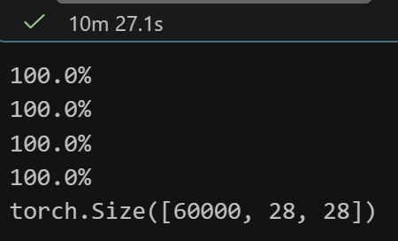
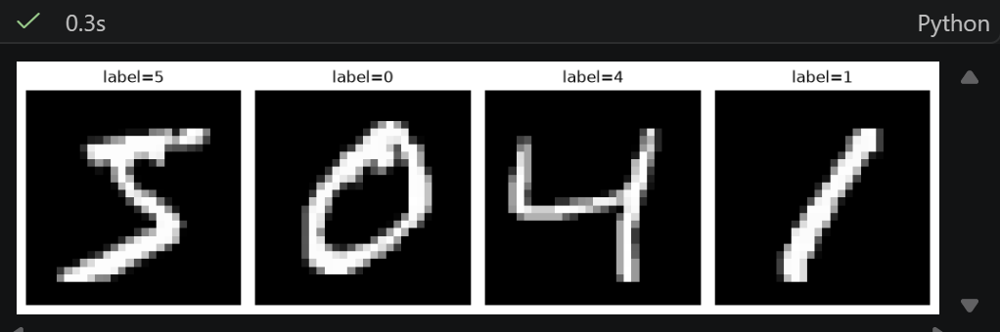
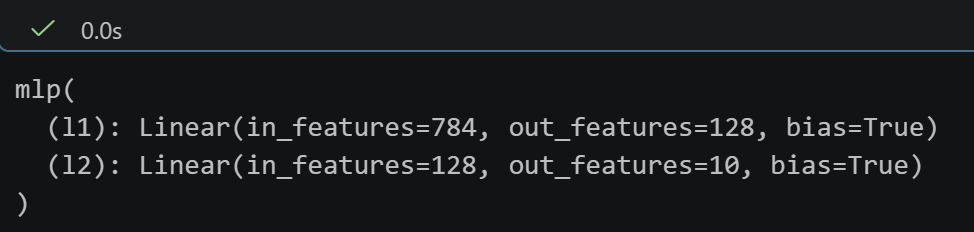
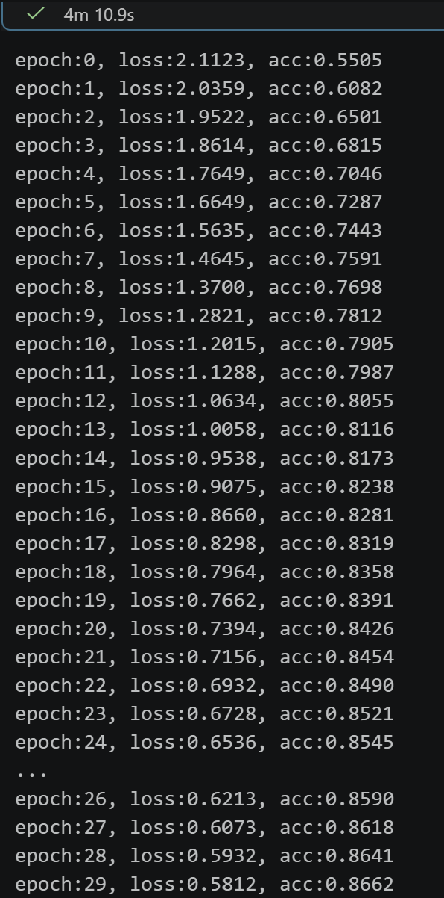
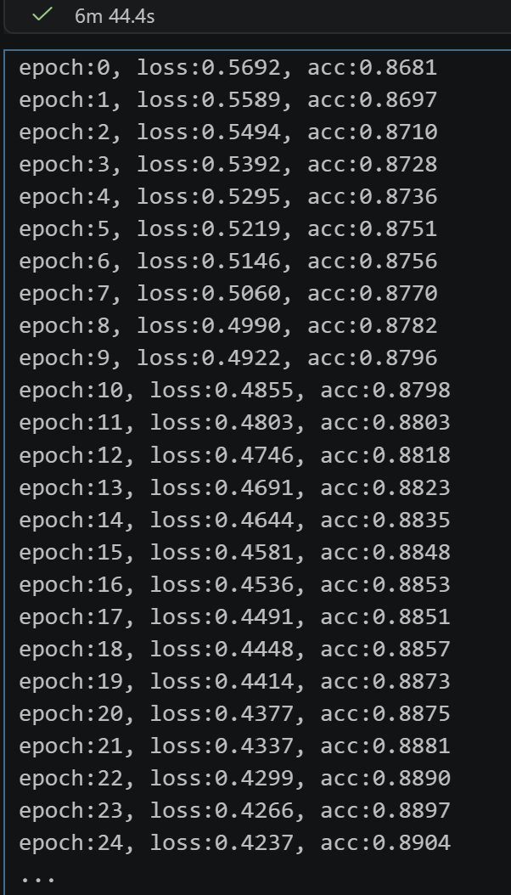
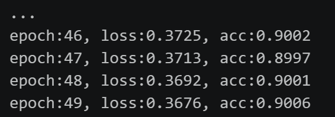

# 实验四 全连接神经网络的实现——实验MNIST数据集
## 一、实验目的
理解全连接神经网络的基本结构与工作原理。

掌握使用 PyTorch 手动构建神经网络的方法。

## 二、实验内容
### MNIST数据集介绍：
MNIST数据集来自美国国家标准与技术研究所,National Institute of Standards and Technology (NIST)。

训练集(training set)由来自250个不同人手写的数字构成,其中50%是高中学生,50%来自人口普查局(the Census Bureau)的工作人员。

测试集(test set)也是同样比例的手写数字数据,但保证了测试集和训练集的作者集不相交。  

MNIST数据集一共有7万张图片,其中6万张是训练集,1万张是测试集。每张图片由28×28的0-9的手写数字像素组成。每个图片是黑底白字的形式,黑底用0表示,白字用0-1之间的浮点数表示,越接近1,颜色越白。

图片的标签以一维数组的one-hot编码形式给出:例如[0,0,0,0,0,1,0,0,0,0]

训练数据集:train-images-idx3-ubyte.gz(9.45 MB,包含60,000个样本)。
训练数据集标签:train-labels-idx1-ubyte.gz(28.2KB,包含60,000个标签)。  
测试数据集:t10k-images-idx3-ubyte.gz(1.57MB,包含10,000个样本)。  
测试数据集标签:t10k-labels-idx1-ubyte.gz(4.43 KB,包含10,000个样本的标签)。

### 导入库
代码块：
```text
import torch
import torch.nn as nn
import torch.nn.functional as F
import torch.optim as optim
import numpy as np
import matplotlib.pyplot as plt
from torchvision import datasets, transforms
```

结果：


说明：
torch.nn是神经网络模块，提供全连接层（nn.Linear()），卷积层（nn.Conv2d()），激活层（nn.ReLU()），交叉熵损失（nn.CrossEntropyLoss()），网络的基类（nn.Module()）

torch.nn.functional提供不需要保存参数的运算。后续有F.relu()，无参数，直接调用，代码简洁

torch.optim优化器，提供各种参数更新算法，有optim.SGD()随机梯度下降，有optim.Adam()

torchvision是PyTorch的计算机视觉工具库，可以提供数据集，预训练模型，图像变换

transforms支持数据预处理与图像增强

### 导入数据集
代码块：
```text
batch_size = 2048
device = torch.device('cpu')
train_loader = torch.utils.data.DataLoader(datasets.MNIST('data', train=True, download=True, transform=transforms.Compose([transforms.ToTensor(),])), batch_size=batch_size, shuffle=True)
test_loader = torch.utils.data.DataLoader(datasets.MNIST('data', train=False, transform=transforms.Compose([transforms.ToTensor(),])), batch_size=batch_size, shuffle=True)

print(train_loader.dataset.data.shape)
```

结果：


说明：
数据集导入成功，用随机梯度下降。

Q:随机梯度下降是看一个样本的loss去更新参数的，为什么这里会有batch？
A:三者的参数更新公式完全一样，区别只在于梯度怎么估计。optim.SGD 根本不"看样本"，即优化器只负责"拿到梯度后怎么更新参数"，不负责梯度是怎么算出来的。它不知道、也不关心 p.grad 是由 1 个样本还是 2048 个样本算出来的。名字里的 "SGD" 指的是这一族"用随机采样梯度做更新"的算法，不是指 batch 大小。

transforms.ToTensor()：把 PIL 图数值范围[0,255]转成float tensor，值域 [0,1]。还把PIL image的H*W*C转换成C*H*W

shuffle=True：每个 epoch 打乱顺序

最后可以看到，有六万张图片，一张图片是28*28大小

### 对数据集前四张图片展示
代码块：
```text
images = train_loader.dataset.data[:4]  
labels = train_loader.dataset.targets[:4]  

fig, axes = plt.subplots(1, 4, figsize=(10, 3))
for i in range(4):
    axes[i].imshow(images[i], cmap='gray')
    axes[i].set_title(f'label={labels[i].item()}')
    axes[i].axis('off')
plt.tight_layout()
plt.show()
```

结果：


说明：
此步我们打印数据集前4张图片看看。前四个image形状：[4,28,28]，labels形状：[4]

plt.tight_layout():自动调整子图间距，防止标题/图重叠

### 手动构建全连接神经网络
代码块：
```text
class mlp(nn.Module):
    def __init__(self):
        super(mlp,self).__init__()
        self.l1=nn.Linear(784,128)
        self.l2=nn.Linear(128,10)

    def forward(self,x):
        a1 = self.l1(x)
        x1 = F.relu(a1)
        a2 = self.l2(x1)
        return a2

model = mlp().to(device)
optimizer = optim.SGD(model.parameters(),lr=0.01)
print(model)
```

结果：


说明：
nn.Module 是 PyTorch 里所有神经网络模块的基类。继承它之后，这个类就可以做到：通过model.parameters()遍历所有可训练参数，通过print打印结构，通过model.to(device)一次性搬移所有参数，model.train()训练模式,model.eval()推理模式

super(mlp,self):初始化一个空的有序字典 _modules，用来存放后面注册的子模块

之后我们通过nn.Linear定义了两层线性层：
l1层：输入784维（28*28展开成一维向量），输出128维，偏置也是128维，一共784*128+128=100480个参数，后面添了一个激活函数
l2层：输入128维，输出10维（对应0~9数字），偏置也是10维，一共有128*10+10=1290个参数

后来，我们定义了一个前向传播forward
我们输入x，输出预测结果，用到了之前定义的两个线性层，使用relu作为激活函数。a2 是 10 个类别的原始得分，不是概率

之后我们把参数等搬到cpu里面，设置随机梯度下降法作为优化器，步长是0.01

我们打印一下model，看到所显示的内容和之前我们描述的一致。

### 训练模型
代码块：
```text
epochs = 30
for epoch in range(epochs):
    model.train()
    for batch_idx, (x,y) in enumerate(train_loader):
        x, y = x. view(x. shape[0],-1).to(device), y.to(device)
        optimizer.zero_grad() # 清空上一步的梯度
        output = model(x)
        loss = F.cross_entropy(output, y)
        loss.backward() # 反向传播梯度
        optimizer.step() # 更新参数

    model.eval()
    correct = 0
    test_loss = 0
    with torch.no_grad():
        for batch_idx, (x,y) in enumerate(test_loader):
            x,y=x.view(x.shape[0],-1).to(device), y.to(device)
            output = model(x)
            test_loss += F.cross_entropy(output, y)
            pred = output.max(1, keepdim=True)[1]
            correct += pred.eq(y.view_as(pred)).sum().item()

    test_loss = test_loss/(batch_idx+1)
    acc = correct/len(test_loader.dataset)
    print('epoch:{}, loss:{:.4f}, acc:{:.4f}'.format(epoch, test_loss, acc))
```

结果：


说明：
整个是两层循环，外部是epoch轮次，内部分为训练和测试。一个epoch需要训练所有的训练数据。训练步骤：展平维度，清理梯度等于0，前向传播，计算交叉熵损失，反向传播，用SDG优化器更新参数。
测试段：换成评估模式eval（），之后关闭梯度，累加loss，取类别，计算正确的分类。

此处可以发现，最后loss一直在下降，acc一直在上升，显然没有收敛，于是我额外跑了一个epoch=50的，效果好了一点，最后正确率在90%左右：



可以发现一个细节，跑50次更快了一点，是因为第一次跑30epoch要读取到内存构造，承担了大部分开销，并且跑50epoch时基本不碰磁盘，在之前的缓存中读取MNIST数据集，除此以外还有CPU预热/频率提升，内存复用等等。

## 三、实验心得
本次实验用 PyTorch 手动实现了一个全连接神经网络并在 MNIST 上完成了训练与测试，从数据加载到模型定义再到训练循环，完整走了一遍深度学习的基本流程。