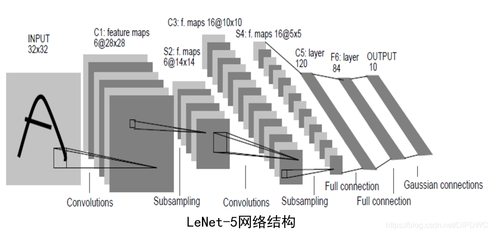
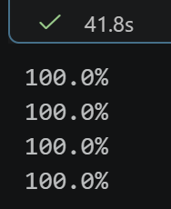
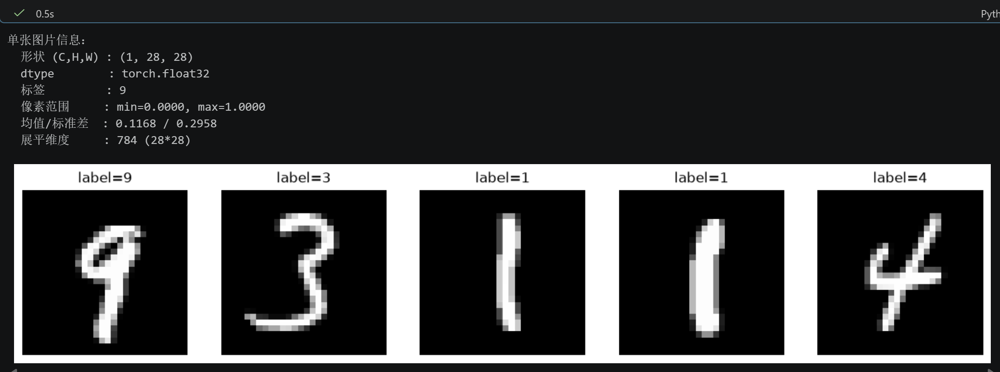
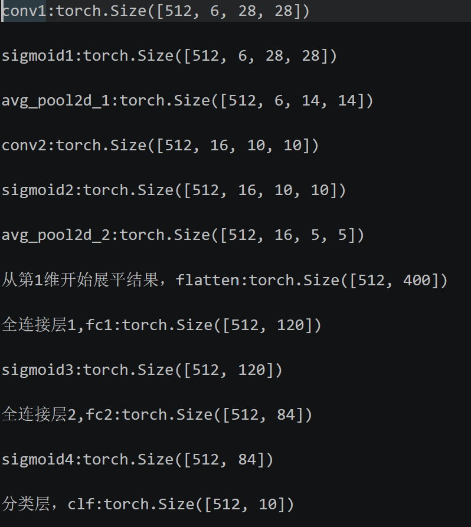
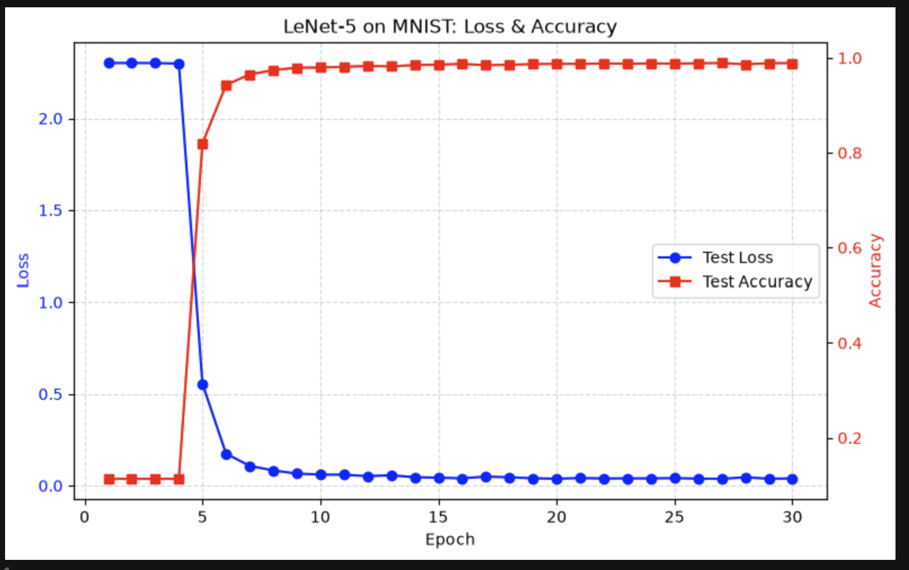
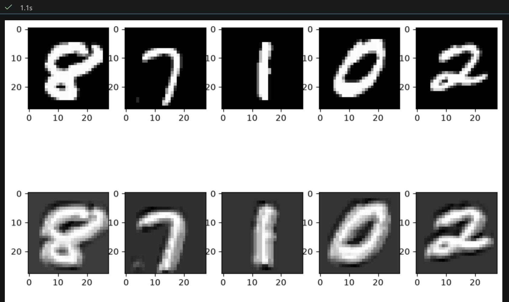
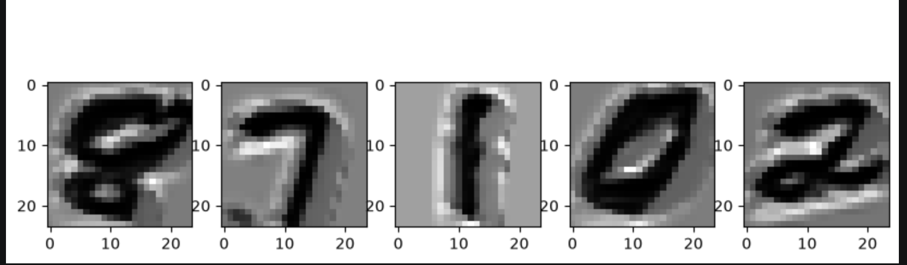

# 实验5 LeNet网络的手动实现
## 实验目的
深入理解经典卷积神经网络 LeNet-5 的底层网络架构与数据流向，掌握卷积层、池化层、全连接层及激活函数的作用。

熟练使用 PyTorch 框架，掌握 nn.Conv2d、nn.Linear 等模块的手动构建方法，以及前向传播 forward 函数中张量形状（Shape）的变化规律。

掌握 MNIST 数据集的加载、预处理（ToTensor）及 DataLoader 的批处理机制。

## 实验内容
### 本次实验的大体说明

如上图，我们要手动实现LeNet-5.我们先来分析一下这个网络。
网络的输入是MNIST手写数字数据集，一张图片通道数：1，高28，宽28.MNIST 数据集共70,000 张，其中，训练集 train=True：60,000 张，测试集 train=False：10,000 张

之后进入第一个卷积层：输入通道1,输出通道6,卷积核5x5,padding=2。即，我们设置了6个卷积核，一个卷积核是5*5大小，图像零填充：2，卷积核的通道数是1.输出是六张特征图，每个特征图对应相应的卷积核要提取的对应特征。之后进入一个激活函数sigmoid型。再进入一个池化层，池化层做平均池化，在2*2大小的区域内取平均得到一个数，步长为2，因此输出的图像又比sigmoid输出的图像少了75%，只有原来的1/4

之后是进入到第二个卷积层：输入通道6,输出通道16,卷积核5x5。即：设置了16个卷积核，一个卷积核还是5*5大小，通道数是6，对应上一层的卷积层：输出6张特征图。图像没有零填充。之后又进入一个sigmoid型函数，再进入一个池化层，池化层做平均池化，在2*2大小的区域内取平均得到一个数，步长为2，因此输出的图像又比sigmoid输出的图像少了75%，只有原来的1/4

之后将二维图像进行flatten展平操作。然后进入全连接层,输入5*5*16,输出120。即：输入16个通道，5*5大小的特征图，拉成一维向量形式，和120个神经元全连接。之后经过一个sigmoid函数。

之后再经过一个全连接层,输入120,输出84，即将前一层的120个神经元和84个神经元全连接。再经过一个sigmoid型激活函数

然后进入分类层,输入84,输出10，即前一层的84个神经元和10个神经元全连接，模型最后一层只输出 logits

### 本次实验的具体实现
我们先导入库
代码：
```text
import torch
import torch.nn as nn
import torch.nn.functional as F
import torch.optim as optim
from torchvision import datasets, transforms
import matplotlib.pyplot as plt
```

结果：


---
之后划分数据集并设置batch_size=512,划分好训练集与测试集
```text
batch_size = 512
device = torch.device('cpu')
trainloader = torch.utils.data. DataLoader(datasets.MNIST('data', train=True, download = True, transform=transforms. Compose([transforms. ToTensor()])), batch_size=batch_size, shuffle=True)
testloader = torch.utils.data.DataLoader(datasets.MNIST('data', train=False, download=True, transform=transforms. Compose([transforms . ToTensor()])), batch_size=batch_size, shuffle=True)
```

结果：


说明：
每次喂给模型 512 张图片做一次前向+反向传播，60,000 张训练集被切成 ceil(60000/512) = 118 个 batch，跑完 118 个 batch 就是 1 个 epoch。

---
让我们来看看单张图片的信息：
代码：
```text
import matplotlib.pyplot as plt

# 从已定义好的 trainloader 取一个 batch，只取前 5 张（不覆盖 trainloader，避免影响后面训练）
images, labels = next(iter(trainloader))
images, labels = images[:5], labels[:5]

# 1. 单张图片信息
img = images[0]
print("单张图片信息：")
print(f"  形状 (C,H,W) : {tuple(img.shape)}")
print(f"  dtype        : {img.dtype}")
print(f"  标签         : {labels[0].item()}")
print(f"  像素范围     : min={img.min():.4f}, max={img.max():.4f}")
print(f"  均值/标准差  : {img.mean():.4f} / {img.std():.4f}")
print(f"  展平维度     : {img.numel()} (28*28)")

# 2. 画出前 5 张
fig, axes = plt.subplots(1, 5, figsize=(15, 3))
for i in range(5):
    axes[i].imshow(images[i].squeeze(0), cmap='gray')
    axes[i].set_title(f"label={labels[i].item()}")
    axes[i].axis('off')
plt.show()
```

结果：


说明：
可以看到我们要处理的图片是1通道，28*28大小的，我们挑了前五张图片进行查看

---
之后是手动实现lenet-5
代码：
```text
# 手动实现LeNet-5网络结构

class Net(nn.Module):
    def __init__(self):
        super(Net,self).__init__()
        self.conv1=nn.Conv2d(1, 6, kernel_size=5, padding=2)    #输入通道1,输出通道6,卷积核5x5,padding=2
        self.conv2=nn.Conv2d(6, 16, kernel_size=5)              #输入通道6,输出通道16,卷积核5x5
        self.fc1=nn.Linear(5 * 5 * 16, 120)                     #全连接层,输入5*5*16,输出120
        self.fc2=nn.Linear(120, 84)                             #全连接层,输入120,输出84
        self.clf=nn.Linear(84, 10)                              #分类层,输入84,输出10

    def forward(self,x):
        # conv1
        x = self.conv1(x)
        print(f"conv1:{x.shape}\n")
        
        # 激活函数sigmoid()
        x = torch.sigmoid(x)
        print(f"sigmoid1:{x.shape}\n")

        # 平均池化层,kernel=2x2,步长2
        x = F.avg_pool2d(x, kernel_size=2, stride=2)
        print(f"avg_pool2d_1:{x.shape}\n")

        # conv2
        x = self.conv2(x)
        print(f"conv2:{x.shape}\n")

        # 激活函数sigmoid()
        x = torch.sigmoid(x)
        print(f"sigmoid2:{x.shape}\n")

        # 平均池化层,2x2,步长2
        x = F.avg_pool2d(x, kernel_size=2, stride=2)
        print(f"avg_pool2d_2:{x.shape}\n")

        # 展平,从第1维开始展平（保留batch维）
        x = x.flatten(1)
        print(f"从第1维开始展平结果，flatten:{x.shape}\n")

        # 全连接层1
        x = self.fc1(x)
        print(f"全连接层1,fc1:{x.shape}\n")

        # 激活函数sigmoid()
        x = torch.sigmoid(x)
        print(f"sigmoid3:{x.shape}\n")

        # 全连接层2
        x = self.fc2(x)
        print(f"全连接层2,fc2:{x.shape}\n")

        # 激活函数sigmoid()
        x = torch.sigmoid(x)
        print(f"sigmoid4:{x.shape}\n")

        # 分类层（不再加softmax，由CrossEntropyLoss内部处理）
        x = self.clf(x)
        print(f"分类层，clf:{x.shape}\n")

        return x
```

结果：


说明：
具体每一层的情况在下一个cell打印

---
之后我们进行训练模型，一共30轮次。
代码：
```text
model = Net().to(device)
optimizer = optim.Adam(model.parameters(), lr=1e-2)
model

epochs = 30
accs, losses = [], []
for epoch in range(epochs):
    for batch_idx, (x,y) in enumerate(trainloader):
        x,y = x.to(device),y.to(device)
        optimizer.zero_grad()
        out = model(x)
        loss = F.cross_entropy(out,y)
        loss.backward()
        optimizer.step()

    correct = 0
    testloss = 0
    with torch.no_grad():
        for batch_idx,(x,y) in enumerate(testloader):
            x,y = x.to(device),y.to(device)
            out = model(x)
            testloss += F.cross_entropy(out,y).item()
            pred = out.max(dim=1, keepdim=True)[1]
            correct += pred.eq(y.view_as(pred)).sum().item()

    acc = correct/len(testloader.dataset)
    testloss = testloss/(batch_idx+1)
    accs.append(acc)
    losses.append(testloss)
    print(f'epoch:{epoch}, loss:{testloss:.4f}, acc:{acc:.4f}')
```

结果：


说明：
如图，上面是第一个epoch的训练情况，记录了每一层的shape。说明如下：
一次epoch就是跑118个batch，一个batch就是跑512张图片。第一层要处理512张图片，一个图片是（28+4）*（28+4）大小（多了零填充），卷积核5*5，根据公式：(H+2P-K)/S+1，得到：28*28的特征图。对应到[512, 6, 28, 28]结果。（具体的卷积核、通道等情况在上面已经讲了）

之后进入的sigmoid激活函数不改变层大小，只改变数值，因此还是[512, 6, 28, 28]

之后进入下采样，2*2大小的窗口，S=2，图片长、宽缩小到原来的25%，即28/2=14为长，宽也是。

然后又是一个卷积层，还是5*5卷积核，根据公式：(H+2P-K)/S+1，得到：10*10大小的图像，对应到结果的：[512, 16, 10, 10]

之后进入下采样，2*2大小的窗口，S=2，图片长、宽缩小到原来的25%，即10/2=5为长，宽也是。

之后进行展平，512个图像，拉成5*5（图像大小）*16（通道数）=400维向量

之后进入全连接层，就是维度数从400到120到84到10的变换，上面讲过了。

每次一个epoch都会输出一个acc，我们来看看：
epoch:1, loss:2.3014, acc:0.1135
epoch:2, loss:2.3011, acc:0.1135
epoch:3, loss:2.2983, acc:0.1135
epoch:4, loss:0.5559, acc:0.8197
epoch:5, loss:0.1748, acc:0.9429
epoch:6, loss:0.1080, acc:0.9650
epoch:7, loss:0.0831, acc:0.9742
。。。
epoch:15, loss:0.0401, acc:0.9872
epoch:20, loss:0.0417, acc:0.9873
epoch:25, loss:0.0384, acc:0.9886
epoch:29, loss:0.0393, acc:0.9890

可以看到loss下降很快，acc到最后一轮可以达到98%的正确率

---
之后绘制loss和acc曲线图：
代码：
```text
import matplotlib.pyplot as plt

epochs_range = range(1, len(losses) + 1)

fig, ax1 = plt.subplots(figsize=(8, 5))

# 左轴：loss
ax1.plot(epochs_range, losses, 'b-o', label='Test Loss')
ax1.set_xlabel('Epoch')
ax1.set_ylabel('Loss', color='b')
ax1.tick_params(axis='y', labelcolor='b')
ax1.grid(True, linestyle='--', alpha=0.5)

# 右轴：accuracy
ax2 = ax1.twinx()
ax2.plot(epochs_range, accs, 'r-s', label='Test Accuracy')
ax2.set_ylabel('Accuracy', color='r')
ax2.tick_params(axis='y', labelcolor='r')

# 合并图例
lines1, labels1 = ax1.get_legend_handles_labels()
lines2, labels2 = ax2.get_legend_handles_labels()
ax1.legend(lines1 + lines2, labels1 + labels2, loc='center right')

plt.title('LeNet-5 on MNIST: Loss & Accuracy')
plt.tight_layout()
plt.show()
```

结果：


说明：
loss下降，acc上升

---
最后将单个特征图拉出来看看
代码：
```text
feature1 = F.sigmoid(model.conv1(x))
# feature1 = F.avg_pool2d(feature1,kernel_size=2,stride=2)
feature2 = F.sigmoid(model.conv2(feature1))
# feature2 = F.avg_poo12d(feature2,kernel_size=2,stride=2)

n = 5
img =x.detach().cpu().numpy()[:n]
feature_map1 = feature1.detach().cpu().numpy()[:n]
feature_map2 = feature2.detach().cpu().numpy()[:n]

fig, ax = plt.subplots(3, n, figsize=(10,10))
for i in range(n):
    ax[0,i].imshow(img[i].sum(0),cmap='gray')
    # ax[0,i].axis('off')
    ax[1,i].imshow(feature_map1[i].sum(0),cmap='gray')
    # ax[1,i].axis('off')
    ax[2,i].imshow(feature_map2[i].sum(0),cmap='gray')
    # ax[1,i].axis('off')
plt.show()
```

结果：



说明：
第一行：原始输入图
第二行：Conv1 的输出叠加
经过了卷积运算，提取的是边缘特征，6 个特征图叠加后，像素值变得不再极端
背景灰化：第一层网络带有偏置（Bias）。即使原图是纯黑（0），经过 卷积 + 偏置 再套上 Sigmoid 激活函数，就会变成一个灰色值

第三行：Conv2 的输出叠加分辨率变小了（第一行 28x28，第三行看起来只有 10x10）。因为经过了两次池化和第二层卷积，尺寸从 28 降到了 10。
背景亮，数字黑：conv2 同样有偏置，且里面有些卷积核的权重可能是负数，导致背景处的激活值被推高（变白），而数字笔画处因为卷积核的负权重抵消，变成了深灰色甚至黑色。

## 实验心得

理解了为什么分类层 self.clf 输出后不需要手动加 Softmax。因为 PyTorch 中的 CrossEntropyLoss 内部自带了 LogSoftmax 操作，如果重复加会导致数值不稳定或梯度衰减。模型最后一层只输出原始得分（logits）是最标准的做法。


